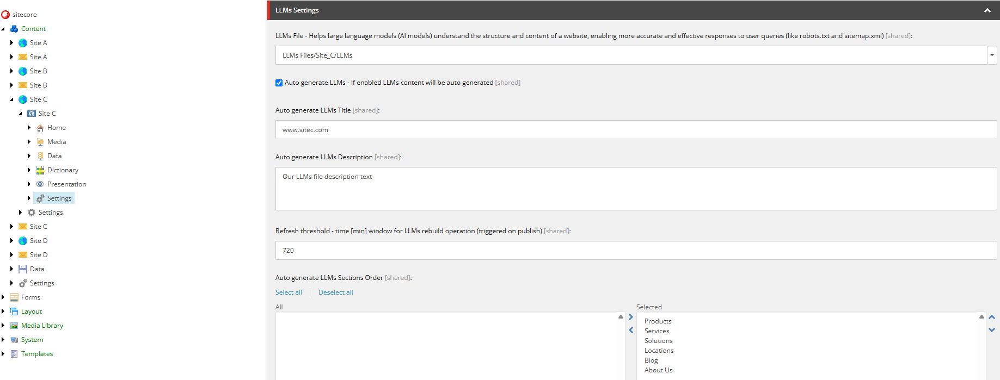
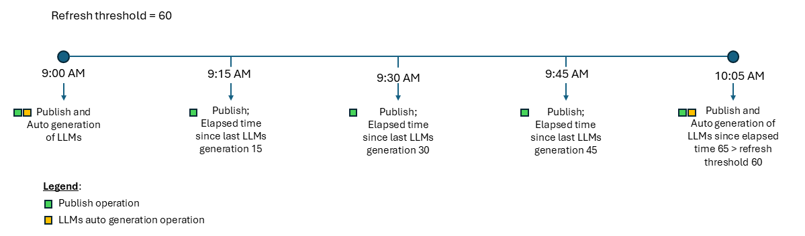
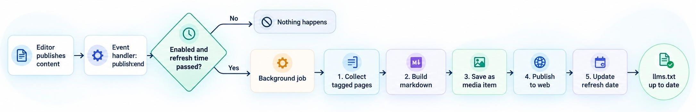
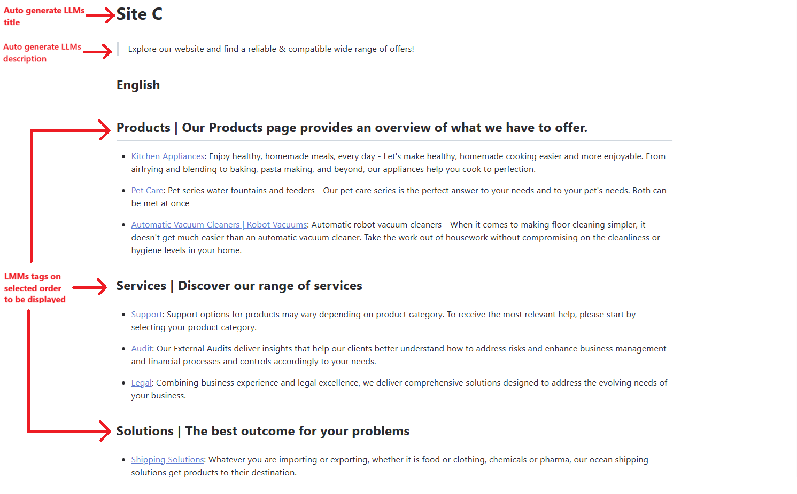

## What is an llms.txt file?
An llms.txt file is a proposed Markdown guide that highlights useful pages on a website for AI tools. It is similar to a sitemap in that it points to website content, but it is meant to be a curated overview, not a complete list of URLs. Whether AI tools read or use the file depends on each tool and until now, adding one does not guarantee greater visibility.

LLMs don't browse your website as a normal user and this is where an llms.txt file may help. It will assist LLMs to understand which content you have on your website and which one is more relevant to what the users are looking for.

When implementing your llms.txt file, you are not improving your website SEO, but your website GEO (Generative Engine Optimization) and AEO (Answer Engine Optimization) which aims to improve your website visibility to AI models.

## Llms.txt file structure
Proposed by Jeremy Howard on September 3rd 2024 at [llmstxt.org](https://llmstxt.org/){:target="_blank"}, the llms.txt file should be using a markdown format, which currently is seen as the most widely and easily understood formats for large language models.

The file itself should be located under your site root and should contain the following structure:
- An H1 with the name of the project or website.
- An optional blockquote with short summary of the project or website, providing key information necessary to understand the rest of the file.
- 0 or more optional markdown sections (except headings) containing more information about the project/website.
- 0 or more markdown sections delimited by H2 headers, containing the list of URLs where further details are available. 
    - Mainly these sections will represent the different areas of the website you want to share with the large language models. For example: Products, About Us, Our Services, etc.

This is an example of the structure of an llms.txt file:

# Title
> Optional description goes here

Optional details go here

## Section name
- [Link title](https://link_url): Optional link details

## Optional
- [Link title](https://link_url)


## Our challenge
When first asked to implement the functionality to display an llms.txt file, it was requested that we enabled content editors to select a file uploaded in Sitecore media library which would be served whenever the visitor reached https://www.example.com/llms.txt.

This was a simple approach which would allow our client to serve this file, however as you might think there are some limitations in this approach. Updating the file is a manual process and if a page gets removed from the live website, the llms.txt file can have references to 404 pages. Besides this, any new page which should be added to the file needs to be manually added.

The initial approach was our stage zero of allowing llms.txt file to be reachable on our client's website, however the manual process involved was a limiting factor and because of that we suggested to proceed with a new implementation which would auto generate the file based on configurations set in Sitecore backoffice.

## Implementing auto-generation of llms.txt file
The auto generation of llms.txt file uses a tagging mechanism to decide which pages to add to the existing file. The solution works based on the following steps:
1. Editors tag the pages they want to include on the llms.txt file (pages with the same tag are displayed under the same section of the final file).
2. A publish event checks whether automatic generation is enabled and due.
3. A background job is created and the updated llms.txt file is published.
4. Requests for /llms.txt are served from the media item configured on that site settings.

### Llms file settings 
To give flexibility to our content team we added a set of settings which allows content editors to define specific properties of the llms.txt file per each of the existing websites they have on Sitecore backoffice.

- **LLMs File**: Path in the media library where llms.txt file content can be found. Can be used to point to either a manual generated file or to the auto generated one.
- **Auto generate LLMs**: If enabled, llms.txt file will be auto generated.
- **Auto generate LLMs Title**: The title used when llms.txt file is set to be auto generated.
- **Auto generate LLMs Description**: The description used when llms.txt file is set to be auto generated.
- **Refresh threshold**: The time in minutes we should wait until the next auto-generation to be executed.
- **Auto generate LLMs Sections Order**: The order by which llms.txt sections should be displayed. A multilist field where content editors can select which LLMs tags they want to include, as well as the order in which they should be displayed. Selected tags are displayed first, in the defined order. Pages tagged with any other LLMs tag for which an order was not defined, are still included in sections placed after the ordered ones.

Our approach to solve the auto generation of llms.txt file is based on how sitemaps are generated when using Sitecore SXA. Everything starts with a custom event handler (we named it "LLMCacheClearer") which we added to Sitecore publish:end event. 

After an item has been published, our custom event handler will decide if the auto-generation of llms.txt file should be executed based on two configurations which are set on each website site settings. The file is auto-generated if:
- Auto-generation of llms.txt file is enabled for the site from where the item is being published.
- The refresh time threshold for the re-generation of the llms.txt file already passed.

The handler is registered on the publish:end event, right after the SXA robots.txt cache clearer, and only on Content Management instances:

<sitecore role:require="ContentManagement or Standalone">
  <events>
    <event name="publish:end">
      <handler type="Site.Feature.Seo.Handlers.LLMCacheClearer, Site.Feature.Seo"
               method="OnPublishEnd" resolve="true"
               patch:after="*[@type='Sitecore.XA.Foundation.SiteMetadata.EventHandlers.RobotsCacheClearer, Sitecore.XA.Foundation.SiteMetadata']" />
    </event>
  </events>
</sitecore>


If both conditions are true, the llms.txt file is auto-generated by calling our custom pipeline named "llmstxt.generateLLMsJob". The pipeline runs inside a Sitecore background job, so publishing is not slowed down, and if a job for the same site is already running no new one is started.

### Generate llms file pipeline
The pipeline itself was split in five different processors, each one responsible for its part of the job:
- **GenerateLlms**: The entry point of the pipeline, responsible for loading configurations set on site settings and for getting the tagged pages which should be displayed under the llms.txt file, for each language of the site. For each page it collects the title, description, URL and tag (section name). 
- **CreateLlmsTxtFile**: Responsible to loop throughout the items collected in the previous step and for formatting the final .md file based on the structure that llms.txt files should follow.
- **GenerateLlmsMediaItem**: Grabs the file content which was generated during the "CreateLlmsTxtFile" processor and creates (or overwrites) an item under the media library, in a folder named after the site (/sitecore/media library/LLMs Files/&lt;site name&gt;/llms.txt).
- **PublishLlmsMediaItem**: After creating the media item, this step publishes it, together with its media library folders, to the same publishing targets of the publish operation which triggered the generation. The "LLMs File" setting of the site must point to this media item.
- **SetRefreshDate**: The final processor of our custom pipeline will set the refresh date to the date and time in which the execution of the pipeline finished. This will play a key role on the next time that the llms.txt file will be auto-generate, since it depends on the threshold set under each site settings plus the date and time of last execution.

The pipeline is declared in configuration with the five processors, executed in this order:

<pipelines>
  <llmstxt.generateLLMsJob>
    <processor type="Site.Feature.Seo.Pipelines.LLMs.GenerateLLMsJob.GenerateLlms, Site.Feature.Seo" resolve="true" />
    <processor type="Site.Feature.Seo.Pipelines.LLMs.GenerateLLMsJob.CreateLlmsTxtFile, Site.Feature.Seo" resolve="true" />
    <processor type="Site.Feature.Seo.Pipelines.LLMs.GenerateLLMsJob.GenerateLlmsMediaItem, Site.Feature.Seo" resolve="true" />
    <processor type="Site.Feature.Seo.Pipelines.LLMs.GenerateLLMsJob.PublishLlmsMediaItem, Site.Feature.Seo" resolve="true" />
    <processor type="Site.Feature.Seo.Pipelines.LLMs.GenerateLLMsJob.SetRefreshDate, Site.Feature.Seo" resolve="true" />
  </llmstxt.generateLLMsJob>
</pipelines>


### Serving llms file (custom HttpRequest processor)
Besides the custom pipeline, we added a custom processor which we named "LLMsFileResolver" to the existing HttpRequest pipeline.
This custom processor will check if the incoming request path is "/llms.txt". In case it is, we would then read the site settings to get which file in media library should be used to serve as the llms.txt content.

The processor is added to the httpRequestBegin pipeline right after the SiteResolver, so the current site is already known when the request reaches it. It is enabled on Content Delivery instances:

<sitecore role:require="Standalone or ContentDelivery">
  <pipelines>
    <httpRequestBegin>
      <processor type="Site.Feature.Seo.Pipelines.LLMsFileResolver, Site.Feature.Seo" resolve="true"
                 patch:after="*[@type='Sitecore.Pipelines.HttpRequest.SiteResolver, Sitecore.Kernel']" />
    </httpRequestBegin>
  </pipelines>
</sitecore>


As a result your llms.txt file should look like this:

## Conclusions
- Llms.txt file is a proposed standard, its adoption is still emerging and its direct impact on search visibility or LLM accuracy is not yet fully guaranteed.
- You can start easy and bring llms.txt file to your client website using manually generated llms.txt files.
- Currently there is no standard on how to display llms.txt file content for multiple languages. We currently decided to create one section per language, followed by one section per tag with the important links of that language.
- Our proposed solution for the auto generation of llms.txt file uses an event handler which was added to the publish:end event to start the generation process and a custom pipeline to build the actual file.

Interested in diving deeper into this or any other Sitecore topic? We’d love to share more about Merkle and our expertise with Sitecore! Don’t hesitate to contact us through this [link](https://www.merkle.com/dach/en/services/sitecore){:target="_blank"}! We’re eager to connect and share insights with you.